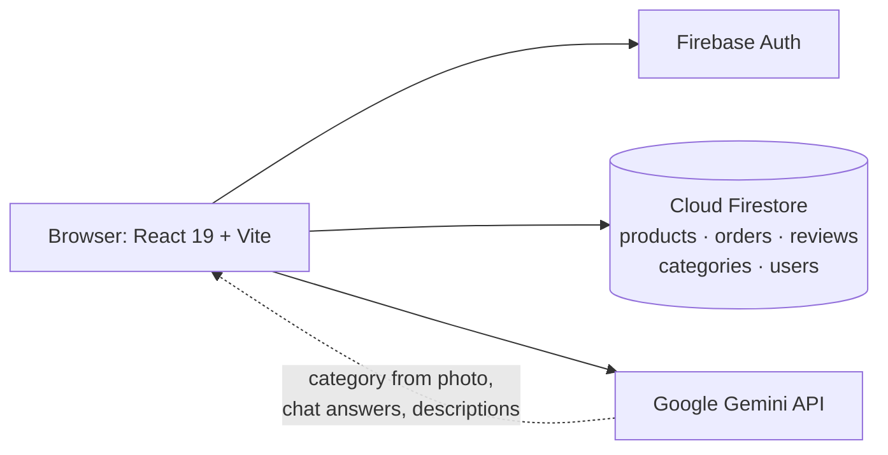

# NexusStore

An e-commerce web app with AI built in. Shoppers can search by uploading a photo and ask a
chatbot about stock, and the admin dashboard has charts and an AI analyst that answers
questions about sales. Built with React 19, Firebase and Google Gemini.

<!-- Demo video: on github.com, edit this file and drag your .mp4 onto this line. -->

<!-- Screenshots: add them to docs/screenshots/ and list them in this table.
| Shop | Visual search | Chatbot | Admin dashboard |
|---|---|---|---|
|  |  |  |  |
-->

## What it does

**AI features (Gemini 2.5 Flash-Lite)**
- **Visual search:** upload a product photo and Gemini picks its category and subcategory
  from the store's own category list, then shows matching products
- **Shopping assistant:** a chatbot that answers questions about prices, stock and sizes
  using the live inventory, and says so when an item isn't stocked
- **Description writer:** admins generate a product description from its name
- **AI analyst:** admins ask questions such as "Which items are low on stock?" and get
  answers drawn from current inventory and recent orders

**For shoppers**
- Search, filter by category, price range and rating, and sort by price
- Product pages with per-size stock, star ratings and written reviews
- Cart and checkout with a simulated bKash payment flow (no real payment is taken)
- Order history and profile editing in a personal dashboard
- Dark mode, and a phone-frame preview of the mobile layout on desktop

**For admins**
- Add, edit and delete products, with stock tracked per size
- Manage categories and subcategories
- Filter inventory by stock level and update order status
- Recharts dashboard: daily sales, orders by status, revenue by category, low stock and top sellers

## How it fits together



Admin pages check the `role` field on the signed-in user's document in the `users`
collection.

## Built with

React 19 · Vite · Tailwind CSS · Framer Motion · Firebase Auth · Cloud Firestore ·
Google Gemini API · Recharts · React Router

## Run it locally

You need Node.js 18 or newer, a free Firebase project and a Gemini API key.

```bash
git clone https://github.com/SaminYeaserKhan/NexusStore.git
cd NexusStore
cp .env.example .env
npm install
npm run dev
```

Fill in `.env` before starting:

1. In the [Firebase console](https://console.firebase.google.com), create a project, add a
   web app, and copy its config values into the `VITE_FIREBASE_*` lines.
2. In the same project, enable **Authentication → Email/Password** (and Google, if you want
   Google sign-in) and create a **Cloud Firestore** database.
3. Get a Gemini API key from [Google AI Studio](https://aistudio.google.com/apikey) and set
   `VITE_GEMINI_API_KEY`.

Then open http://localhost:5173.

**Become an admin:** sign up in the app, then in the Firebase console open Firestore →
`users` → your user's document and change `role` from `user` to `admin`.

**Load sample products:** once you're an admin, open `/seed`. It replaces every product with
35 samples.

> The Gemini key is used from the browser, so anyone using a deployed copy can read it.
> Before deploying, restrict the key to your site's domain in Google Cloud Console, or move
> the Gemini calls behind a server function.

## License

MIT. See [`LICENSE`](LICENSE).
